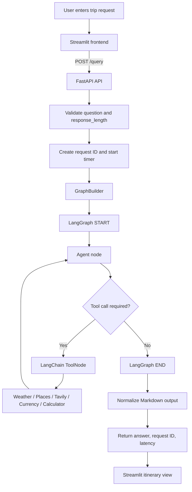

# Wanderly AI Trip Planner

Wanderly is an AI-powered travel planner that creates day-by-day itineraries with destination research, weather, activities, restaurants, transport suggestions, and expense estimates.

## Features

- Streamlit UI with example prompts, backend status, conversation history, and Markdown download
- FastAPI backend with `/health` and `/query` endpoints
- LangGraph agent loop with conditional tool routing through LangChain tools
- Configurable response styles with token budgets (`short`, `standard`, `detailed`)
- Request IDs, latency metrics, structured logs, and LangSmith-compatible run metadata
- Groq-powered travel planning
- Weather, Google Places, Tavily fallback search, currency conversion, and trip calculators
- Configurable model in `config/config.yaml`

## Requirements

- Python 3.10+
- A Groq API key
- Optional keys for weather, Google Places, Tavily, and currency conversion tools

## Setup

Install dependencies with uv:

```powershell
uv pip install -r requirements.txt
```

Create a `.env` file in the project root. Use the exact variable names below:

```env
GROQ_API_KEY=your_groq_key
OPENWEATHERMAP_API_KEY=your_openweather_key
GPLACES_API_KEY=your_google_places_key
TAVILY_API_KEY=your_tavily_key
EXCHANGE_RATE_API_KEY=your_exchange_rate_key
```

The Google Places, weather, Tavily, and exchange-rate keys support tool features. Keep `.env` private and never commit real keys.

Optional LangSmith observability can be enabled in `.env`:

```env
LANGCHAIN_TRACING_V2=true
LANGCHAIN_API_KEY=your_langsmith_key
LANGCHAIN_PROJECT=wanderly-trip-planner
```

When enabled, each request is tagged with its response style and request ID so you can inspect graph runs, tool calls, latency, and failures in LangSmith.

## Run the application

Start the backend in one terminal:

```powershell
uv run uvicorn main:app --reload
```

Start the Streamlit UI in a second terminal:

```powershell
uv run streamlit run app.py
```

Open the URL printed by Streamlit, usually `http://localhost:8501`.

The backend API is available at `http://localhost:8000`. Test its health endpoint:

```powershell
curl http://localhost:8000/health
```

## API example

```powershell
curl -X POST http://localhost:8000/query `
  -H "Content-Type: application/json" `
  -d '{\"question\":\"Plan a 5-day trip to Goa\", \"response_length\":\"standard\"}'
```

## Project structure

```text
agent/            LangGraph workflow
config/           Model configuration
prompt_library/   Travel-agent system prompt
tools/            LangChain tools
utils/            API clients and shared helpers
app.py            Streamlit frontend
main.py           FastAPI backend
```

## Architecture and resume highlights

### End-to-end workflow



### Pipeline steps

1. The user submits a destination, duration, and preferences in the Streamlit UI.
2. Streamlit sends `question` and the selected response style (`short`, `standard`, or `detailed`) to `POST /query`.
3. FastAPI validates the request with Pydantic, generates a unique request ID, and starts a latency timer.
4. `GraphBuilder` loads the configured Groq model and applies the response-specific token budget.
5. LangGraph runs the agent node. The LangChain model decides whether external tools are needed.
6. If a tool call is returned, the conditional edge routes execution to `ToolNode`.
7. The selected LangChain tool runs and returns data to the agent node:
   - Weather through OpenWeather
   - Attractions, restaurants, activities, and transport through Google Places
   - Tavily as a place-search fallback
   - Currency conversion through ExchangeRate-API
   - Expense calculations through local calculator tools
8. The graph loops between the agent and tools until the model produces the final itinerary.
9. FastAPI removes leaked HTML line-break tags, records latency, and returns the answer with observability metadata.
10. Streamlit renders the Markdown itinerary and provides a download option.

### LLMOps and observability

- Response styles control prompt instructions and model token budgets.
- Every request receives a `request_id` for debugging and correlation.
- API logs record response style, latency, and failures.
- LangGraph runs include a run name, response-style tags, and request metadata.
- Optional LangSmith tracing can inspect graph nodes, tool calls, latency, and failures.

This architecture demonstrates an agentic RAG-style workflow rather than a single LLM call: the model reasons over the request, conditionally invokes specialized tools, observes their results, and then produces a grounded response.
